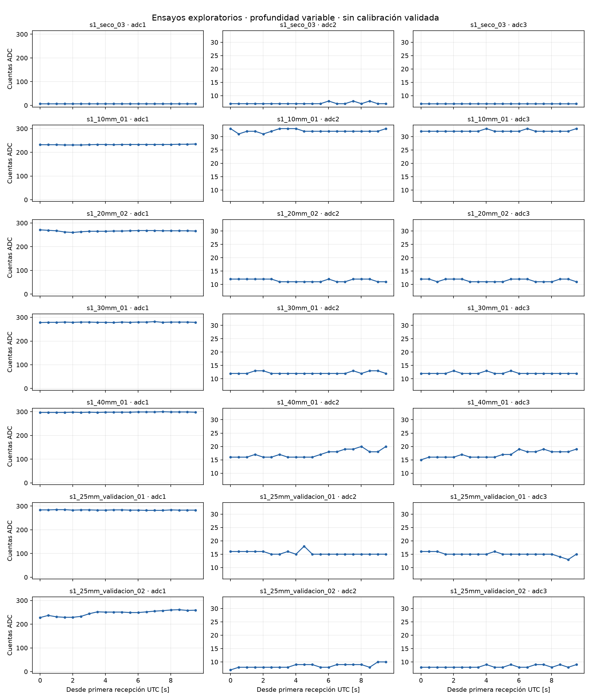

# Mediciones auditadas y nueva clasificación RGB preparada

La nueva clasificación ADC está implementada y probada para los tres LED,
sin alterar los pines. Se compilaron las variantes con salidas deshabilitadas
y habilitadas, pero no se cargó firmware. Los ensayos existentes se analizaron
sin nuevas capturas ni modificaciones a los originales. La profundidad variable
impide considerar definitiva la calibración.

## Qué contienen realmente los archivos

| Conjunto | Archivos CSV | Filas | Lecturas ADC (3 por fila) |
|---|---:|---:|---:|
| Principales de calibración de la sesión | 10 | 181 | 543 |
| Incluidos en el resumen preliminar | 7 | 140 | 420 |
| Intentos excluidos del resumen | 3 | 41 | 123 |
| Preparación, contada aparte | 5 | 20 | 60 |

Los siete ensayos resumidos contienen **140 lecturas por cada sensor**; solo
S1/A0 tiene inmersión comunicada por el usuario. S2/A2 y S3/A3 también fueron
registrados en cada trama como canales consecutivos, pero sin altura o
condición física asignada. No se extrapola la caracterización de S1 a ellos.
«140 filas del resumen» no significa 140 observaciones aptas para calibración.

Las tres exclusiones son: 20 filas de `s1_seco_01` recibidas en una ráfaga de
unos 2 ms; una fila de `s1_seco_02` antes de corregir el EOF por timeout;
y 20 filas de `s1_20mm_01`, con salto inicial de 40500 ms. Los siete ensayos
resumidos tienen 19 intervalos Arduino de 500 ms y unos 9,52 s entre primera
y última recepción UTC. Los bytes de arranque se conservan y no se convierten
arbitrariamente en nuevas muestras con condición conocida.

## Estadísticas y estabilidad

Media, mínimo, máximo, desviación muestral, varianza, rango, mediana, rango
intercuartílico (IQR) y cambio entre la media de la segunda y primera mitad
se exportaron para **cada canal de los diez ensayos**, incluidos los excluidos.
Un ensayo de una sola muestra tiene desviación y varianza indefinidas, no cero.
No se eliminaron valores atípicos ni se filtraron datos.

| Condición comunicada S1 | Media ADC1 | Desviación | Mín.–máx. | Rango | IQR |
|---|---:|---:|---:|---:|---:|
| Seco | 7,00 | 0,00 | 7–7 | 0 | 0 |
| 10 mm | 232,65 | 1,04 | 231–235 | 4 | 1 |
| 20 mm | 266,20 | 2,46 | 260–271 | 11 | 2,25 |
| 30 mm | 279,50 | 0,89 | 278–282 | 4 | 1 |
| 40 mm | 298,10 | 0,91 | 297–300 | 3 | 2 |
| 25 mm, primera comprobación | 283,40 | 0,88 | 282–285 | 3 | 1 |
| 25 mm, repetición | 246,80 | 11,40 | 228–261 | 33 | 19,5 |

La repetición de 25 mm cambia +16,6 ADC entre las medias de sus dos mitades,
frente a desviaciones inferiores a 2,5 ADC en los otros seis ensayos. Su
inestabilidad es visible y no queda resuelta por una media. Las medias iniciales
crecen, pero la comprobación de 25 mm no reproduce esa curva: la diferencia
entre las medias de sus dos intentos es 36,6 ADC. El usuario confirmó movimiento
lateral y vertical durante la manipulación; no se registró su amplitud. No se
atribuye el error exclusivamente a histéresis ni al sensor.

En los siete ensayos, S2 tiene medias de 7,15 a 32,15 ADC y desviaciones por
ensayo de 0,37 a 1,41; S3 tiene medias de 7,00 a 32,15 y desviaciones de 0 a
1,23. Son relativamente poco variables dentro de cada ensayo, pero sus niveles
cambian entre ensayos. Sin condiciones independientes registradas, no prueban
estabilidad a una altura fija ni respuesta correcta a inmersión. Una desviación
nula tampoco significa ausencia de incertidumbre.

La interpolación existente sigue sin modificar: los errores diagnósticos de
S1 a 25 mm fueron +7,10 mm y −10,78 mm desde el ADC medio. No se habilita una
conversión a centímetros ni porcentajes para uso final.

## Gráficas y reproducibilidad

Se reutiliza `python.graficas.mediciones` para siete PNG de los tres canales,
y se añade una comparación de 7 ensayos × 3 canales. Las escalas se comparten
por columna; ADC1 y ADC2/3 tienen escalas diferentes para ver su variación.
Todos los ejes son cuentas ADC frente a tiempo de recepción, sin altura inferida.



- [Estadísticas de los 30 conjuntos ensayo/canal](../datos/calibracion/sesion_2026-10-16_01/analisis_rgb_02/estadisticas.csv).
- [Auditoría con recuentos, estados y huellas SHA-256](../datos/calibracion/sesion_2026-10-16_01/analisis_rgb_02/auditoria.json).
- [Detalle temporal de la repetición inestable](../datos/calibracion/sesion_2026-10-16_01/analisis_rgb_02/adc_s1_25mm_validacion_02.png).

Para reproducir, elegir un directorio de salida **nuevo**:

```bash
.venv/bin/python -m python.analisis_sesion --sesion datos/calibracion/sesion_2026-10-16_01/sesion.json --salida /tmp/awa-analisis-reproduccion
```

El analizador valida columnas, ADC, marcas UTC, orden y SHA-256 disponible,
rechaza fuentes duplicadas y no sobrescribe el destino ni CSV originales.
El resumen antiguo conserva sus estadísticas correctas de ADC1; se corrigió
su descripción de recuentos y se enlazó esta ampliación a los otros canales.

## Firmware RGB y validación de software

| Intervalo ADC inclusivo | Color | R/G/B |
|---|---|---|
| 0–49 | Verde | 0/1/0 |
| 50–149 | Azul | 0/0/1 |
| 150–299 | Morado | 1/0/1 |
| 300–1023 | Rojo | 1/0/0 |
| Valor inválido | Apagado | 0/0/0 |

`ColoresNivel.h` añade azul y sustituye los límites anteriores por la función
de un argumento `colorParaAdc(adc)`. `NivelAguaR4.ino` mantiene LED1 R2/G3/B4,
LED2 R7/G6/B5 y LED3 R10/G9/B8, con lectura independiente por sensor. El
arranque mantiene los nueve canales apagados. `NIVEL_AGUA_LED=0` es el valor
predeterminado hasta revisar corriente y resistencias; con 1 se aplica la tabla.

Las nuevas pruebas fallaron con la lógica anterior y pasaron con la nueva.
Cubren 0..1023 completo, fronteras 49/50, 149/150 y 299/300 en ambos sentidos,
valores negativos y superiores a 1023, cambio entre colores sin canales
residuales e independencia por LED. Se prueba serial con LED activos y LCD
con LED activos/desactivados mediante E/S simulada. La trama CSV, los pines
ADC, resolución, cadencia, desbordamiento de millis y texto LCD se conservan.
No hay prueba física del nuevo firmware porque no se ha cargado.

La suite completa ejecutó **47 casos: 46 aprobados y 1 omitido** por ausencia
de qrcode/OpenCV. Comando: `.venv/bin/python -m unittest discover -s tests -v`.

Compilaciones UNO R4 WiFi, core instalado, salida 0:

| Variante | Programa | Variables globales | Directorio |
|---|---:|---:|---|
| LED deshabilitados | 59232 bytes | 9020 bytes | `/tmp/awa-rgb-20261016-default` |
| LED habilitados | 59280 bytes | 9020 bytes | `/tmp/awa-rgb-20261016-enabled` |

Se conserva el aviso conocido de arquitectura de LiquidCrystal_I2C, sin fallo
de compilación. Los comandos de compilación se documentan en la guía del
firmware; no se ejecutó ningún comando de carga.

## Qué falta antes de activar

Arduino especifica 8 mA por GPIO. Las resistencias «220» no están identificadas
ni verificadas por canal. Se documentó el cálculo y la comprobación necesaria
en [CONEXIONES_LED.md](CONEXIONES_LED.md), con fuente oficial. El software queda
preparado, pero no se recomienda habilitar físicamente las salidas todavía.

Al aplicar la nueva tabla a las 140 filas resumidas, S1 tendría 20 verdes,
119 moradas y 1 roja; S2 y S3 tendrían 140 verdes cada uno. No se observó
ningún ADC en la banda azul. Son predicciones de software, no colores físicos
verificados ni límites de altura. La muestra roja de S1 implica dos cambios
previstos morado/rojo cerca de 300; se evaluó el riesgo de parpadeo y se mantiene
la tabla exacta sin histéresis hasta acordar otra política.

El siguiente paso físico es identificar, sin alimentación, las nueve
resistencias y la correspondencia de canales/cátodo, y revisar la corriente.
Después se podrá solicitar autorización de carga y observar cada LED con
su ADC. No se pide repetir la calibración para comprobar esta clasificación
provisional. ThingsBoard y QR permanecen en [fase de propuesta](THINGSBOARD_QR_PREPARACION.md).
